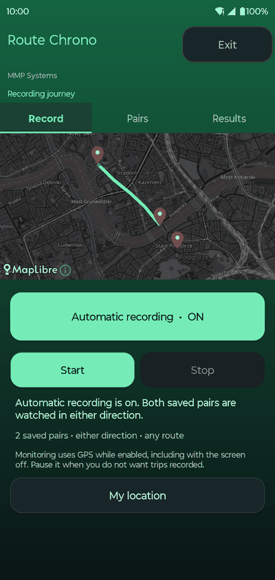
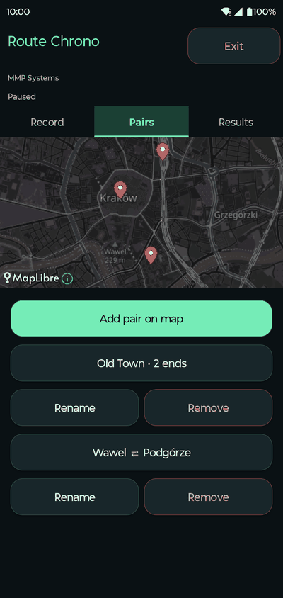
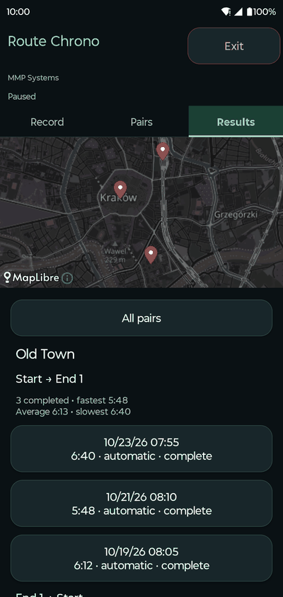
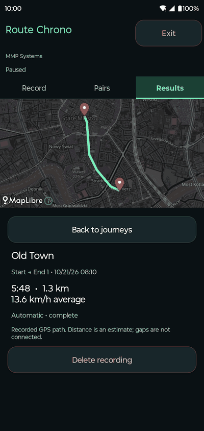

# Route Chrono

**Time your regular trips automatically, by any route, in both directions.**

<p align="center">
  
  
  
  
</p>

## About

Route Chrono is an Android app by MMP Systems that answers "how long does this trip really take?". Save the places you travel between — once by recording a trip, or by tapping them on a map — and the app recognises every later departure and arrival on its own. Each trip is stored with its GPS path, time, distance and average speed, and repeat trips are summarised as fastest, average and slowest.

Everything stays on the phone: there is no account, backend or cloud sync.

## Features

- **Automatic trip detection** between saved endpoints, in either direction and along any road.
- **Learn by doing:** press Start, travel, press Stop, and the trip's ends become a saved pair.
- **Plan on a map:** tap a start and an end, or add an optional second end — trips from the start finish at whichever end is reached first.
- **Several pairs at once**, each tracked independently.
- **Results per direction** with a map of every path, plus fastest / average / slowest times.
- **Ignores wrong turns:** a trip that strays more than 1.5× the endpoint distance from where it started is discarded, with a silent notification.
- **Honest data:** GPS gaps and implausible jumps mark a trip as interrupted instead of guessing.
- **Visible and stoppable:** a notification shows whenever tracking runs; **Exit** stops everything.

## How it works

```text
Start → travel → Stop ──────┐
                           ├→ saved endpoint pairs
Choose endpoints on a map ─┘          ↓
                          automatic outward / return trips
                                      ↓
                          recorded maps + times + statistics
```

A trip starts when the phone leaves the 50 m zone around an endpoint and ends on arrival within 50 m of the destination. Details and limits are in [phone usage](docs/phone-testing.md).

## Install

There is no prebuilt release yet; build the APK from source. You need [Docker](https://docs.docker.com/get-docker/) (no Java or Android SDK on the host) and, for installing, [`adb`](https://developer.android.com/tools/releases/platform-tools). The phone needs Android 8.0 or newer with USB debugging enabled.

```sh
git clone https://github.com/michalpiekos/RouteChrono.git
cd RouteChrono
./scripts/build.sh                          # tests, debug APK, lint
adb devices                                 # find DEVICE_SERIAL
./scripts/install-phone.sh DEVICE_SERIAL    # install and open
```

`DEVICE_SERIAL` is the identifier listed by `adb devices`. The first build downloads the toolchain and dependencies; see [build details](docs/build.md).

## Usage

1. **Record** — grant precise location and notifications. Press **Start** at your starting point, travel, and press **Stop** at the destination. Endpoints over 150 m apart become a saved pair and automatic recording turns on.
2. **Pairs** — tap **Add pair on map**, set the start and end (and optionally **end 2**), name it and save. Rename or remove pairs here; removing keeps past results.
3. Travel as usual. With **Automatic recording · ON**, trips between saved points are recorded in the background.
4. **Results** — pick a pair to see trips grouped by direction with timing summaries; open one for its map, distance and speed, or delete it.
5. **Exit** (in the app or the notification) stops all tracking and closes the app; it stays paused until you start again.

## Development

```sh
./scripts/build.sh                                          # JVM tests, debug APK, lint
./scripts/build.sh :app:assembleDebugAndroidTest            # instrumentation APK
adb -s DEVICE_SERIAL install -r app/build/outputs/apk/androidTest/debug/app-debug-androidTest.apk
adb -s DEVICE_SERIAL shell am instrument -w dev.mmp.go.test/androidx.test.runner.AndroidJUnitRunner
```

Arguments to `build.sh` are Gradle tasks. Instrumentation tests use isolated databases and leave app data untouched. Add `-e captureReadme true -e class dev.mmp.go.ReadmeScreenshotsTest` to regenerate the screenshots above from synthetic data.

More: [build details](docs/build.md) · [architecture](docs/architecture.md) · [phone usage](docs/phone-testing.md) · [verification log](docs/verification.md)

## Privacy

Locations, trips and statistics are stored only in the app's local database. The only network traffic is map tiles from OpenStreetMap, shown with attribution. GPS is used only while recording or monitoring is enabled, always with a visible notification.

## License

[MIT](LICENSE) © 2026 MMP Systems Michal Piekos
